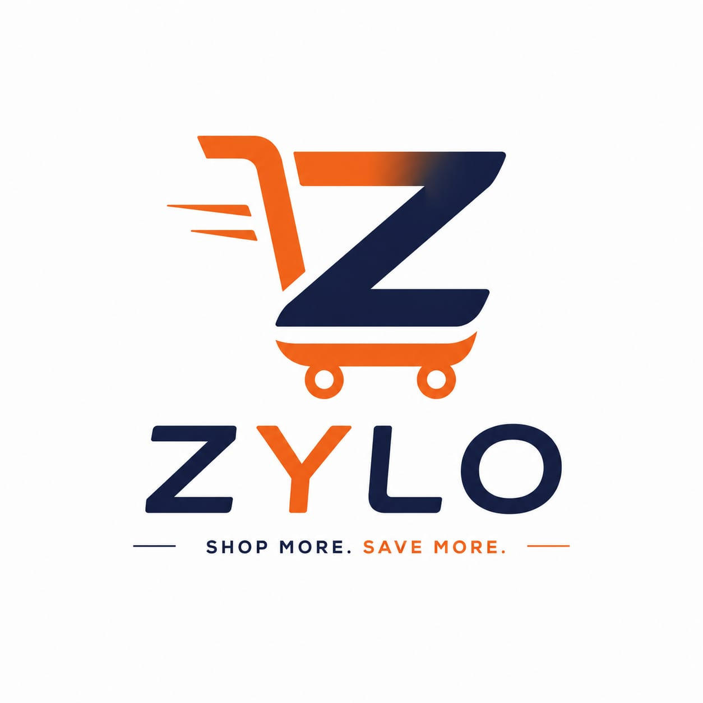

# ZYLO — Shop more. Save more.

An animated e-commerce storefront built with Next.js 16, TypeScript, Tailwind CSS 4 and
Framer Motion. Amazon-class feature surface, original dark design.



## What's in it

**Storefront**
- Home with parallax hero, floating product collage, category rail and three product rails
- Search with live suggestions in the header (image + price preview)
- Listing page with multi-select category filters, price slider, rating filter and five sort modes
- Product page with thumbnail gallery, hover-zoom, buy box, ratings breakdown and reviews
- Related-products rail on every product page
- Cart drawer with quantity controls, free-delivery progress meter, savings total and
  `localStorage` persistence

**Catalog**
- 194 products across 24 categories with real images, brands, ratings, reviews, stock,
  shipping and return terms
- Prices rendered in INR

**Motion**
- Scroll-linked parallax in the hero, scroll-triggered reveals with stagger across sections
- Pointer-tracked 3D tilt and a cursor-following glow on product cards
- Spring-physics cart drawer and mobile filter sheet
- Animated SVG logo (the Z draws itself, wheels spin, speed lines shift on hover)
- Every animation respects `prefers-reduced-motion`

## Stack

| | |
|---|---|
| Framework | Next.js 16 (App Router, Turbopack) |
| Language | TypeScript |
| Styling | Tailwind CSS 4 |
| Animation | Framer Motion |
| Icons | lucide-react |

## Run it

```bash
pnpm install
pnpm dev
```

Open http://localhost:3000.

```bash
pnpm build   # 199 pages prerendered
```

## Structure

```
src/
├── app/
│   ├── page.tsx              # home
│   ├── search/page.tsx       # listing + filters
│   ├── product/[id]/page.tsx # product detail (SSG, 194 pages)
│   ├── layout.tsx
│   └── globals.css           # brand tokens
├── components/               # Header, Hero, ProductCard, CartDrawer, …
├── lib/
│   ├── catalog.ts            # catalog queries, search, sort, INR pricing
│   └── cart.tsx              # cart context + localStorage
└── data/products.json        # 194-product catalog
```

## Notes

Cash-on-delivery checkout persists orders and reserves stock. Online payments are not
connected. The initial sample catalog comes from [DummyJSON](https://dummyjson.com); manage your own listings in the business dashboard.

## Business dashboard

Open `/admin` to manage products, stock, orders, customers, sales reports and store settings. The storefront and dashboard use the same database, with secure owner access and cash-on-delivery checkout.

See [Zylo Business setup and operations](docs/business-dashboard.md) for migrations, your one-time owner setup link, order rules, exports and test instructions.

Customer email/password and Google sign-in are available at `/login`, with signup, private order history and password reset. See [customer account setup](docs/customer-accounts.md) for managed-auth environment settings, domain configuration and the customer-order migration.
